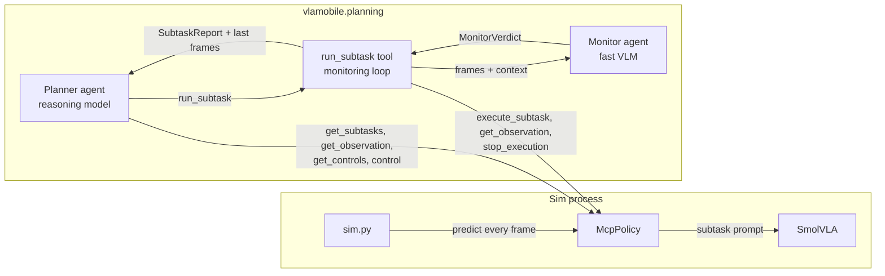

# Planning, Execution and Monitoring Harness

An agentic harness that drives the simulated mobile lift robot through the MCP
server in [`vlamobile/mcp_policy.py`](../mcp_policy.py). The harness takes a
composite task (e.g. *"Pick up the cube and place it on the red platform"*),
breaks it into the low-level subtasks the VLA was trained on, runs them one at a
time, and watches each one until it succeeds or fails.

It is built from two [PydanticAI](https://ai.pydantic.dev/) agents with
different jobs and different latency budgets:

| Agent | Role | Model profile | Runs |
|---|---|---|---|
| **Planner** | Planning and execution: decompose the task, choose the next subtask, react to reports (continue, retry, replan, give up) | Strong reasoning model, extended thinking allowed | Between subtasks, while the robot is stopped |
| **Monitor** | Monitoring and reporting: judge from camera frames whether the running subtask is still progressing, has succeeded, or has failed | Fast vision-language model | Every monitoring tick, while the robot is moving |

The separation follows from the timing of the system. The VLA runs at the sim
frame rate (30 fps) inside the MCP server and needs no LLM in the loop. The
planner may take a few seconds to think, which is fine as long as the robot
is stopped while it does; tens of seconds is too long even then. While a
subtask is running, the robot keeps moving, so the agent that decides when to
stop it must answer within a second or two.

## How it fits together



The sim is started with `--policy_type=mcp` (see the `mcp` configurations in
`.vscode/launch.json`), which serves the robot at `http://127.0.0.1:8000/mcp`.
The harness runs as a separate process and connects to that URL with
PydanticAI's `MCPToolset`.

## MCP tools and who uses them

| Tool | Used by | Purpose in the harness |
|---|---|---|
| `get_subtasks` | Planner | The subtask vocabulary. Plans may only contain these exact prompts. |
| `get_observation` | Planner, monitoring loop | The current task string, camera images and robot state. |
| `get_controls` | Planner | Action layout and limits, needed before any raw `control` call. |
| `control` | Planner (sparingly) | Short corrective maneuvers the VLA has no subtask for, e.g. backing away from an obstacle. |
| `execute_subtask` | Monitoring loop only | Started open-ended (no `num_frames`), so it returns immediately and the VLA keeps driving until the harness stops it. |
| `stop_execution` | Monitoring loop | Stops the running subtask or control chunk. Zeroes forward and turn while holding grip and lift, so a carried cube is not dropped. |

`execute_subtask` and `stop_execution` are filtered out of the planner's
toolset (via `MCPToolset.filtered(...)`). The planner can only start a subtask
through the harness tool `run_subtask`, which guarantees that every subtask run
is monitored, bounded by a timeout, and stopped when it ends.

## Execution flow

1. **Orient.** The planner reads the composite task (passed on the command
   line, or taken from the `task:` line of `get_observation`, which carries the
   sim's `policy_task`), calls `get_subtasks`, and looks at the current scene.
2. **Plan.** It writes an ordered plan made of subtask prompts from the
   vocabulary and records it with the `set_plan` tool, so the harness can
   report "2/4 done, in progress: Go to red platform".
3. **Execute.** For each step it calls `run_subtask(subtask)`, which:
   1. starts `execute_subtask(subtask)` open-ended;
   2. every monitoring tick, fetches `get_observation` and asks the monitor for
      a `MonitorVerdict`;
   3. calls `stop_execution` as soon as the verdict is `succeeded` or `failed`,
      or a deterministic guard trips (timeout, no progress over the last N checks);
   4. returns a `SubtaskReport` together with the final camera frames.
4. **React.** While the robot is stopped, the planner reads the report and the
   frames and decides whether to continue with the next step, retry the same
   subtask, insert a corrective step, replan from the current scene, or give
   up.
5. **Finish.** The planner's run ends with a structured `EpisodeResult`.

The planner's own agent loop is the executor: plan, `run_subtask`, read the
report, and decide, all as tool calls within one `planner.run(...)`. No
separate state machine is needed, because PydanticAI already provides the
loop, while the data that must be reliable (verdicts, reports, the result) is
typed.

## The monitoring loop

The loop is plain Python inside `run_subtask`. The monitor agent has no tools:
each tick is a single structured-output request with the frames attached as
images. That keeps the monitor at one model round trip per tick, which is what
makes it low latency.

```python
async def run_subtask(ctx: RunContext[HarnessDeps], subtask: str) -> ToolReturn:
    history: list[MonitorVerdict] = []
    try:
        await ctx.deps.robot.execute_subtask(subtask)      # open-ended, returns immediately
        while not timed_out(...) and not stalled(history):
            obs = await ctx.deps.robot.observe(image_size=cfg.monitor_image_size)
            result = await monitor_agent.run(
                [render_monitor_prompt(subtask, history), *obs.images.values()],
                usage=ctx.usage,
            )
            verdict = result.output
            ctx.deps.events.emit(subtask, verdict)         # live reporting
            history.append(verdict)
            if verdict.status != "running":
                break
    finally:
        await ctx.deps.robot.stop_execution()              # also on errors and cancellation
    obs = await ctx.deps.robot.observe(image_size=cfg.monitor_image_size)
    return make_report(subtask, history, obs)              # report text + frames of the stopped robot
```

Design choices:

- **Current frames plus a text history.** Like the existing in-process
  planner in `vlamobile/models/planning/`, the monitor sees only the latest
  frames plus a short text history of its previous verdicts (progress and
  rationale), never old images. This keeps prompt size, and therefore latency,
  constant over a long subtask.
- **Tick rate set by monitor latency.** The next tick starts when the previous
  verdict arrives, with a configurable minimum period. Smaller images
  (`image_size`) are the main lever for lowering latency.
- **Code-level guards.** Timeouts and stall detection (progress not increasing
  over the last N verdicts) are implemented in Python, not left to the model.
- **Reporting.** Every verdict is emitted as an event (console log and Logfire
  trace), so a human can follow progress live. The `SubtaskReport` is the
  condensed version handed back to the planner.

## Data contracts

All agent outputs are Pydantic models, so PydanticAI validates them and asks
the model to retry when its output doesn't fit.

```python
class MonitorVerdict(BaseModel):
    status: Literal["running", "succeeded", "failed"]
    progress: float = Field(ge=0, le=1)
    rationale: str                     # one sentence, what the frames show

class SubtaskReport(BaseModel):
    subtask: str
    outcome: Literal["succeeded", "failed", "timed_out", "stalled", "interrupted"]
    duration_s: float
    checks: int
    final_progress: float
    summary: str                       # rationale of the last verdicts

class EpisodeResult(BaseModel):
    success: bool
    summary: str
    attempts: list[SubtaskReport]
```

`HarnessDeps` (the PydanticAI `deps_type`) holds the MCP connection wrapper,
the config, the current plan, the attempt history and the event sink. Both
agents share the run's usage counter, so one `UsageLimits` caps the whole
episode.

## Proposed layout

```
vlamobile/planning/
├── README.md       # this file
├── config.py       # HarnessConfig: MCP URL, model names, tick period, timeouts, retry limits
├── types.py        # MonitorVerdict, SubtaskReport, EpisodeResult, HarnessDeps
├── robot.py        # thin MCP client: observe, execute_subtask, stop_execution (direct tool calls)
├── prompts.py      # system prompts for both agents
├── monitor.py      # monitor agent and the run_subtask monitoring loop
├── planner.py      # planner agent, its toolset and set_plan / run_subtask tools
└── run.py          # CLI entry point (fire): connect, run one episode, print the result
```

Model names are plain PydanticAI model strings in `HarnessConfig`, so either
agent can be pointed at a hosted model or at a local OpenAI-compatible server
(e.g. a llama.cpp VLM for the monitor) without code changes.

## Skills

The planner and the monitor can load
[Agent Skills](https://pydantic.dev/docs/ai/harness/skills/) from a folder given
by `--skills_dir`. Each skill is a subfolder with a `SKILL.md`:

```
my_skills/
└── recover-dropped-cube/
    └── SKILL.md
```

```markdown
---
name: recover-dropped-cube
description: Use when the cube was dropped while carrying it.
---

Back away from the platform, then re-plan from "Pick up the cube".
```

Each agent sees only each skill's name and description, and loads the body
with the `load_capability` tool when it needs it. Monitor runs are independent
per tick, so a skill the monitor loads costs one extra model request on every
tick that loads it.

```
python -m vlamobile.planning.run --skills_dir=my_skills --task="..."
```

## Gaps in the MCP server

`stop_execution` covers ending an open-ended subtask: it zeroes forward and
turn while holding grip and lift, so the harness does not have to guess
commanded grip and lift values.

One server-side addition would still make the harness more robust:

- **Run status in `get_observation`.** An open-ended subtask that is
  interrupted by an env reset or a joystick override disappears silently.
  Reporting the currently running subtask (or none) in `get_observation` would
  let the monitoring loop return an `interrupted` report instead of waiting for
  the monitor to notice.

## Relation to `vlamobile/models/planning/`

The existing planner runs in-process inside the policy's `predict` loop, with
a single VLM doing both decomposition and assessment. This harness replaces
that with an out-of-process, tool-using setup over MCP. The sim stays
unchanged, the planner and monitor can use different models, and the planner
can use raw `control` for recovery when no subtask fits.
